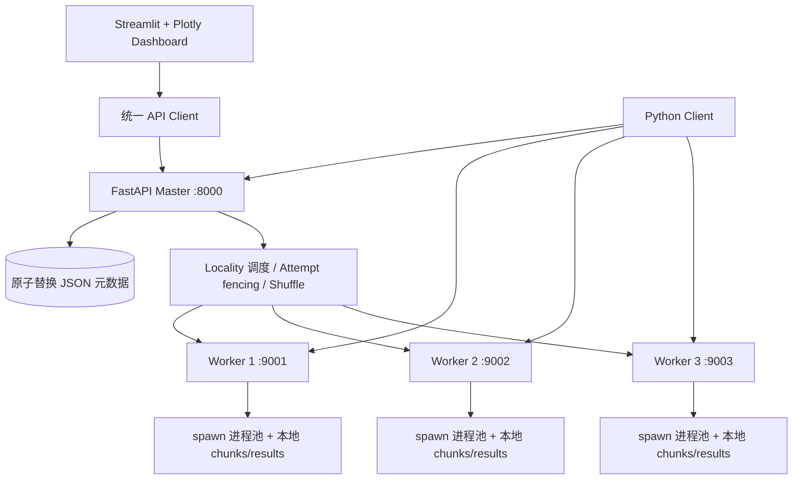
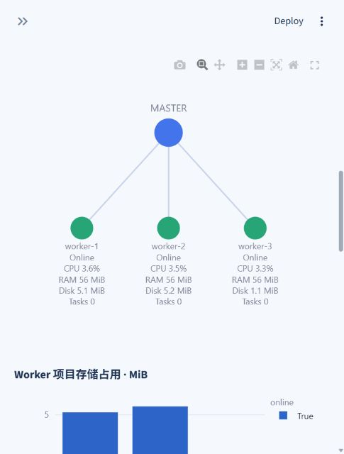

# MiniGFS + MiniMapReduce

Lightweight Distributed Storage and Computing System — 教学型轻量级分布式存储与计算系统。

本项目在独立目录中从零实现 Python 分布式框架：Master、多个 Worker、Streamlit Dashboard 均为独立进程，通过真实 HTTP 通信。未使用 Hadoop、Spark、Ray 或 Celery；不需要 Docker、云服务或付费 API。演示中的节点、数据、计算结果、任务时间线和性能数据全部来自实际运行。

## 快速启动（Windows / Python 3.11+）

在本项目目录打开 PowerShell：

```powershell
.\start.ps1
```

首次运行创建 `.venv` 并在依赖缺失时安装依赖；后续运行直接检查环境并启动。默认端口：Master 8000、Worker 9001–9003、Dashboard 8501。只绑定 `127.0.0.1`。

- Dashboard：<http://localhost:8501>
- Master Swagger：<http://localhost:8000/docs>
- Worker Swagger：<http://localhost:9001/docs>

如果 PowerShell 的策略禁止脚本，可使用纯 Python 入口，或仅为当前命令允许脚本：

```powershell
powershell -ExecutionPolicy Bypass -File .\start.ps1
# 停止本项目记录的进程及其子进程
.\stop.ps1
```

停止会校验 PID、进程创建时间、工作目录和启动参数，避免 PID 重用时误杀其他程序。端口占用、启动失败、健康检查超时均会报错并回收本次已启动进程。

Ubuntu / 纯 Python：

```bash
python3 -m venv .venv
source .venv/bin/activate
python -m pip install -r requirements.txt
python -m scripts.start_cluster
python -m scripts.stop_cluster
```

Windows 下纯 Python 命令使用 `.\.venv\Scripts\python.exe`。以下示例中的 `python` 均指项目虚拟环境解释器。

需要复用本次验证过的主要依赖版本时，安装 `requirements-tested.txt`。该文件固定直接依赖版本；`docs/environment.json` 同时记录本次实测版本。

## 架构



**存储：** 默认 4 MiB 切块；SHA-256 同时覆盖单块及完整文件；不同 Worker 上存储两个副本；允许单节点降级，零在线节点拒绝上传。Master 回读确认副本后才能标记 stored；所有 Chunk 至少一个 stored 副本才能完成文件。副本持久状态和 Worker 心跳在线状态独立。

**计算：** WordCount 每 Chunk 一个 Map；优先数据本地性并限制节点并发；Map 在 Worker 本地保存中间结果；Master 读取一次被接受的结果、使用 SHA-256 分区并传给真实 Reduce Worker；最终按分区合并。Monte Carlo 使用确定性分片种子，每个 Map 在独立 CPU 进程执行，Reduce 汇总整数计数。

**重试：** 每个逻辑 Task 有唯一 task_id，每次尝试有唯一 attempt_id；连接故障、节点离线、节点重启、执行异常和超时触发最多 3 次重试（总共 4 次尝试）。轮询仅接收当前 attempt 的结果，重复请求不重复执行，迟到结果不参与聚合。

## 目录

```text
common/       Pydantic 请求/响应模型、原子写入、路径校验
config/       集中配置和环境变量
minigfs/      Master、元数据、切块、上传下载 Client
minimr/       异步调度器、WordCount/Monte Carlo/Shuffle/Reduce 算法
worker/       HTTP 服务、不可变 Chunk 存储、spawn 进程池执行器
dashboard/    七个页面、统一 API Client、共用图表组件
benchmarks/   后台实验执行、串行基准、CLI
scripts/      启停、PID 管理、数据生成、真实集成测试、页面检查
tests/        Pytest 算法、接口、状态、重试、路径安全测试
docs/         设计、API、实验、演示、开发与实际验证记录
data/         运行时元数据、日志、Chunk、中间结果、实验输出（Git 忽略）
```

## 文件上传与下载

Dashboard 的“分布式文件管理”可上传、查看副本矩阵、下载校验和保存文件。也可使用 CLI：

```powershell
python -m scripts.generate_dataset --mb 5 --output data/datasets/demo.txt
python -m minigfs.client upload data/datasets/demo.txt
python -m minigfs.client download data/recovered.txt --file-id <上传返回的file_id>
```

生成器支持 `--mb 1`、`10`、`50`、`100` 或任意正数，不会在启动时自动生成大型文件。下载按 Chunk index 排序，失败副本自动切换，校验全部成功后才替换目标文件；失败时清理 `.partial` 文件并保留已有目标。

## WordCount 实验

1. 上传英文文本（可含其他 UTF-8 内容）。
2. 在任务中心选择 `wordcount` 和输入文件，配置 Worker/Reduce 数并提交。
3. 查看实时 Map → Shuffle → Reduce 状态、任务分配和甘特图。
4. 在 WordCount 页查看 Top 20、词频分布、各任务耗时、真实中间计数、搜索结果并导出 CSV。

词定义为正则 `[A-Za-z]+`，统一小写，标点、数字和非 ASCII 字符均为分隔符。UTF-8 多字节内容不会被错误解码成英文字符；不提供中文分词或带重音字母的 Unicode 单词统计。跨块单词归属**第一个英文字节所在 Chunk**：忽略本块开头延续部分，读取后续块补全末尾单词；可处理跨越多个 Chunk 的长单词。单机基准 `minimr.algorithms.wordcount` 使用相同规则。

## Monte Carlo π 实验

在任务中心或 π 页面设置采样次数、分片数量、Worker 数及种子。推荐先用 100 万；也支持 500 万、1000 万、5000 万或自定义值。图表显示最多 2000 个真实样本点、真实批次累计收敛、误差、Worker 分工和执行时间。收敛曲线按分片索引顺序拼接批次，不伪装为各进程实时完成顺序。

每个 Worker 默认 1 个计算槽。需要每 Worker 两个计算进程时：

```powershell
.\stop.ps1
.\start.ps1 --slots 2
```

提交 Job 的 `max_concurrency` 不能扩大 Worker 启动时的槽容量。三节点只保证有三个可选 Worker；调度会在可用槽之间实际分发任务。

## 性能实验

性能页一键启动串行 + 1/2/3 Worker，每组至少重复 3 次。支持 WordCount 和 Monte Carlo，历史比较、CSV/JSON 导出和 Plotly 图表 PNG 下载。

```powershell
python -m benchmarks.monte_carlo_benchmark --samples 1000000 --workers 1 2 3 --repeats 3
python -m benchmarks.wordcount_benchmark --file-id <file_id> --workers 1 2 3 --repeats 3
```

实验自动验证每个分布式结果等于固定种子的串行基准。记录墙钟时间、任务累计计算时间、Map/Shuffle/Reduce、阶段外协调时间、应用载荷字节、资源采样、重试次数、均值/中位数/标准差。数据落盘在 `data/benchmarks/<id>/results.json` 和 `results.csv`。

Speedup 使用 **串行纯计算均值 / 分布式端到端均值**；效率为 Speedup / Worker 数。通信与调度开销可能显著大于计算，结果可以比串行慢。不要用小样本的演示数据宣称分布式性能优势。详细计时口径见 [实验设计](docs/experiment.md)。

## 故障容错实验

故障页仅能启动、停止或重启本项目启动器登记的 Worker，不能接收任意命令或管理其他程序。默认心跳 3 秒，10 秒后 Offline；计算任务可能先通过连接失败检测故障。

存储演示：双副本上传 → 停 Worker → 心跳超时 → 矩阵降级 → 下载 → SHA-256 一致。

计算演示：提交足够长的 Monte Carlo → 任务 running 时停 Worker → 查看失败 attempt 与另一节点上的重试 → 完成并比较相同种子的整数计数。详见 [课堂流程](docs/demo.md)。

## 可视化页面

| 页面 | 内容 |
|---|---|
| 集群总览 | KPI、真实拓扑、存储柱状图、CPU/内存历史、事件筛选 |
| 分布式文件管理 | 上传下载、文件表、切块结构、副本矩阵、健康度、校验结果 |
| 任务中心 | 参数提交、阶段流程、进度、分配表、各尝试甘特图、事件 |
| WordCount | Top 20、频率分布、Worker 输入量、任务耗时、搜索与导出 |
| Monte Carlo π | 真值/估计/误差、真实散点、批次收敛、Worker 负载 |
| 性能分析 | 实验配置、耗时/加速/效率、分布与误差条、历史、环境与导出 |
| 故障演示 | 受控 Worker 启停、受影响 Chunk、重新分配、恢复时间线 |

侧栏可暂停自动刷新、手动刷新和切换深色图表/界面。上传、表单输入或投影演示时可暂停刷新。

## 测试

```powershell
python -m pytest -q
python -m scripts.integration_test
# 启动集群并创建 WordCount、π、Benchmark 结果后：
python -m scripts.dashboard_check
```

集成测试自动选择空闲端口、使用临时目录、实际启动三个 Worker，进行 >4 MiB 上传下载、真实停机、副本恢复、WordCount、Monte Carlo 中途故障重试、重复尝试去重、Master 重启和失败下载清理，最后回收测试进程。无需先启动默认集群。

页面检查使用 Streamlit 官方 AppTest，调用真实后端，不替换 API 数据。测试结果见 [验证记录](docs/validation.md) 与相邻 JSON 文件。Windows 已实际验证；Ubuntu 提供兼容代码但未在此环境实测。

源码和文档的实际文件清单见 [FILES.txt](docs/FILES.txt)。真实运行截图：



## API 示例

```powershell
$body = @{job_type='monte_carlo'; samples=1000000; partitions=6; worker_count=3; seed=42} | ConvertTo-Json
$job = Invoke-RestMethod http://127.0.0.1:8000/jobs -Method Post -ContentType 'application/json' -Body $body
Invoke-RestMethod "http://127.0.0.1:8000/jobs/$($job.job_id)"
Invoke-RestMethod "http://127.0.0.1:8000/jobs/$($job.job_id)/result"
```

完整接口见 [api.md](docs/api.md) 与运行中的 Swagger。

## 常见问题与局限

- **端口被占用**：启动器会明确拒绝，不会杀死占用者。可指定 `--master-port 18000 --worker-base 19000 --dashboard-port 18501`；启动器会把后端地址传给全部子进程。
- **无法连接**：先看 `data/logs/master.log`、`worker-N.log` 和 `dashboard.log`；确保使用项目虚拟环境。
- **没有加速**：小任务的 HTTP、轮询、进程启动、数据分组开销可能占主导。参考真实原始测量，不删异常慢样本。
- **Worker 数量增加但无更多并行**：检查在线数、任务分片数以及 Worker 启动槽数。
- **Master 重启**：文件和已结束任务保留；进行中的 Job 明确标记 failed，不自动恢复。Worker 重新心跳注册；已停止节点在重新注册前不列入 Worker 总数。
- **存储损坏**：下载/计算会校验并尝试其他副本；不实现自动副本修复、损坏副本回写或数据垃圾回收。
- **规模上限**：Master 内存集中 Shuffle，元数据为整体 JSON；完整词频和中间结果会常驻内存，适用于课程规模而非生产大数据。历史 Job/文件/中间结果需离线归档；实时事件限 2000 条，监控历史限 1200 个采样，实验资源采样限 12000 条。
- **安全边界**：本机教学服务，无认证/TLS，不能对公网开放。Worker 注册仅允许环回主机；对象路径受 ID 校验及数据目录约束；无任意代码或 shell 执行接口。
- **非完整 GFS**：不实现租约、Primary 写流水线、追加事务、Master HA、Raft/Paxos、跨机安全认证、自动副本修复。
- **CPU 口径**：同机所有 Worker 的 CPU 数为主机整体利用率，不可求和；内存为各 Worker 进程树 RSS，存在共享页重复计量。

更多：[架构](docs/architecture.md) · [开发说明](docs/development.md) · [实验设计](docs/experiment.md) · [演示流程](docs/demo.md)
